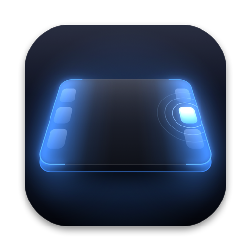
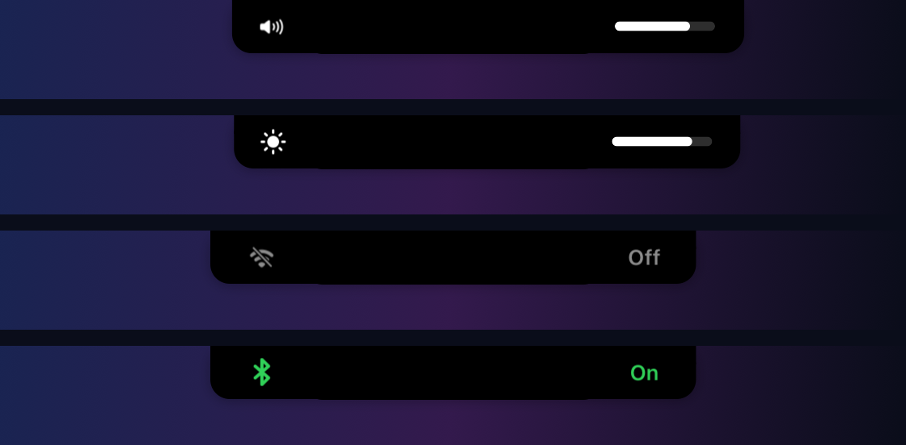
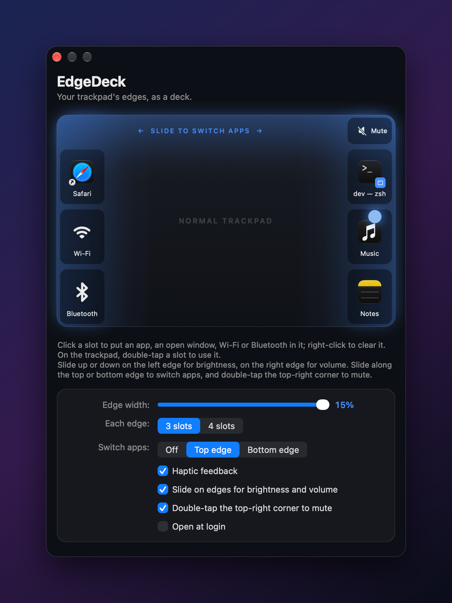

<p align="center">
  
</p>

<h1 align="center">EdgeDeck</h1>

<p align="center">
  <b>Turn your MacBook trackpad's edges into a Stream Deck.</b><br>
  Double-tap an edge to open apps, jump to windows or flip Wi-Fi and Bluetooth.<br>
  Slide along the edges for brightness and volume, with haptic ticks and a live notch display.
</p>

<p align="center">
  
  
  
  
</p>

<p align="center">
  
</p>

---

## What it does

The middle of your trackpad stays a normal trackpad. Its edges become a deck:

| On the trackpad | What happens |
| --- | --- |
| **Double-tap** a slot on either edge | Runs that slot: opens an app, brings a window to the front, or toggles Wi-Fi / Bluetooth |
| **Slide up/down** on the **left** edge | Brightness, in 16 steps like the keyboard keys |
| **Slide up/down** on the **right** edge | Volume (sliding up also unmutes) |
| **Slide left/right** along the **top** edge | Switch apps: a bar of your open apps appears in the middle of the screen, the highlight follows your finger, and lifting switches to that app |
| **Double-tap** the **top-right corner** | Mute / unmute |

- **3 or 4 slots per edge**, stacked top to bottom.
- **Adjustable edge width**, from 8% to 15% of the trackpad on each side.
- **App switching on the top or bottom edge**, your choice (or off). It brings back hidden and minimized apps too, like clicking their Dock icon.
- **Haptic feedback** from the trackpad itself: a tick per step, a firmer tap when something opens. At 0% or 100% the ticks stop, so you can feel the limit.
- **Window slots**: pick any open window (say, one of three Terminal windows) and double-tap to jump straight to it. When that window closes, its slot empties itself.
- **Wi-Fi and Bluetooth toggles** that show their new state on the notch.
- **No stray clicks**: taps on a filled slot never reach the app under your cursor.
- **Smart about gestures**: two-finger scrolls and other multi-finger gestures are left alone, and a slide stops the moment your finger leaves the edge.

## The notch

Nothing pops up in the middle of your screen. The notch stretches sideways: the icon slides out of its left end and the value out of its right, then both tuck back in.

<p align="center">
  
</p>

While you slide, the bar follows your finger. Toggle again while it's showing and it updates in place.

## Settings

A small dark window from the menu bar icon. It draws your trackpad with the deck zones glowing at the edges. Click a slot to fill it, right-click to clear it. While the window is open, your fingers show up live on the drawing, so you can see exactly where the zones are.

<p align="center">
  
</p>

## Light on memory

EdgeDeck is a menu bar app written in Swift and plain AppKit, with no SwiftUI, no Electron and no third-party dependencies.

- **About 12 MB of RAM and 0% CPU** while idle.
- The settings window and the notch display are created only when needed. The settings window is thrown away when you close it.
- Trackpad touches arrive from the system's own multitouch driver, so nothing polls in the background.

## Install

You need macOS 13 or later, a MacBook with a Force Touch trackpad, and the Xcode Command Line Tools (`xcode-select --install`).

```bash
git clone https://github.com/thecidsama/EdgeDeck.git
cd EdgeDeck
./build.sh
open build/EdgeDeck.app
```

To keep it, move `build/EdgeDeck.app` to `/Applications` and turn on **Open at login** in its settings.

### Permissions

| Permission | Needed for |
| --- | --- |
| **Accessibility** | Window slots (listing, focusing and watching windows) and keeping slot taps from clicking the app underneath |
| **Bluetooth** | The Bluetooth toggle (asked the first time you use it) |

Apps, Wi-Fi, brightness, volume, mute, app switching, haptics and the notch display work without any permission.

> **Rebuilt the app?** The build is signed ad hoc, so macOS treats every rebuild as a new app. Remove EdgeDeck from **System Settings → Privacy & Security → Accessibility** and add it again.

## How it works

| Piece | Built on |
| --- | --- |
| Finger positions | `MultitouchSupport.framework`, the private framework behind trackpad gestures |
| Haptics | The trackpad's actuator (`MTActuator`), with `NSHapticFeedbackManager` as a fallback |
| Brightness | `DisplayServices.framework` (built-in display) |
| Volume | CoreAudio, on the default output device |
| Wi-Fi / Bluetooth | CoreWLAN / IOBluetooth |
| Windows | The Accessibility API, plus an `AXObserver` that notices when a window closes |
| App switcher | Apps in front-to-back order from the window list, shown in a blurred panel that only exists while you slide |
| Notch display | A borderless panel with Core Animation springs, only on screen while it's showing |

Because EdgeDeck uses private Apple frameworks (the same ones tools like BetterTouchTool rely on), it can't ship on the Mac App Store, and a future macOS update could break parts of it.

## Project layout

```
Sources/CTouch/          C bridge: raw touches, trackpad haptics, brightness
Sources/EdgeDeck/
  Engine.swift           Edge zones, double-tap detection, slides
  Controls.swift         Volume, brightness, slot actions, Wi-Fi/Bluetooth, haptics
  Windows.swift          Listing, focusing and watching windows
  AppSwitcher.swift      The app switcher bar
  NotchDrop.swift        The notch display
  SettingsWindow.swift   Settings window and trackpad drawing
  Settings.swift         Preferences
Resources/               Info.plist and app icon
build.sh                 Builds build/EdgeDeck.app
```

## License

[MIT](LICENSE) © thecidsama
